<div align="center">

# Koto Pai?

**Bill splitting that adds up to the last poisha — and a ledger that remembers who owes whom.**

*"Koto pai?" is Bengali for "how much do I get?"*

[](https://github.com/narukami00/Koto-Pai/actions/workflows/ci.yml)


**[Live app](https://koto-pai-aatd.onrender.com)** ·
**[Health check](https://koto-pai-aatd.onrender.com/actuator/health)** ·
**[Deployment guide](DEPLOYMENT.md)** ·
**[Manual test script](MANUAL_TEST.md)**

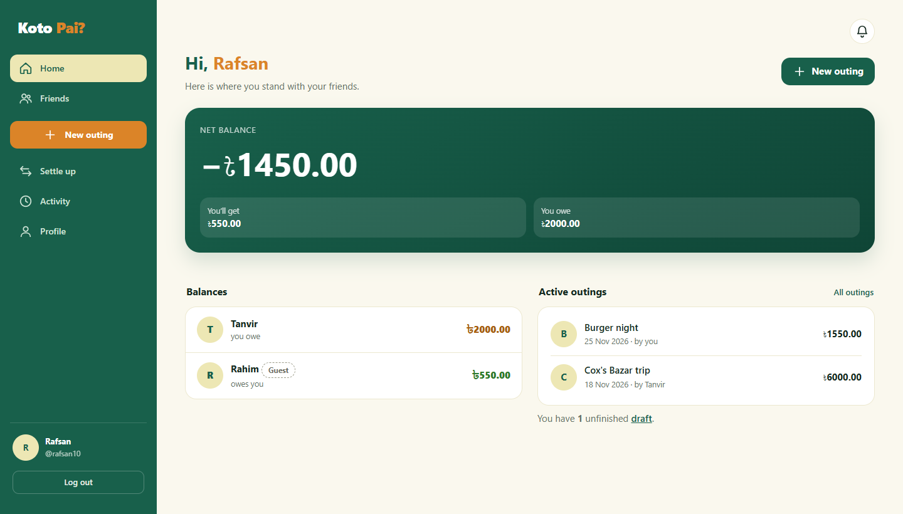

</div>

> **Try it now:** open the live app and log in as `rafsan10`, `tanvir_h`, `nabila_r` or `samiha`
> with password `password123` (demo accounts, public by design). The Admin Console is not public: the administrator
> is a real account set through configuration (see [`DEPLOYMENT.md`](DEPLOYMENT.md)).
> The app runs on a free Render instance, so the first request after idle can take about a minute while it wakes up.

---

## Contents

1. [What it does](#1-what-it-does)
2. [Features and how they work](#2-features-and-how-they-work)
3. [Architecture](#3-architecture)
4. [Data model](#4-data-model)
5. [REST API](#5-rest-api)
6. [Software design: patterns and principles](#6-software-design-patterns-and-principles)
7. [Design decisions](#7-design-decisions)
8. [Security](#8-security)
9. [Testing](#9-testing)
10. [CI/CD and Git workflow](#10-cicd-and-git-workflow)
11. [Run it locally](#11-run-it-locally)
12. [Docker, hosting and monitoring](#12-docker-hosting-and-monitoring)
13. [Project management and team](#13-project-management-and-team)
14. [Limitations and future work](#14-limitations-and-future-work)
15. [Repository map](#15-repository-map)

---

## 1. What it does

Friends remember who paid. They rarely remember who consumed what. **Koto Pai?** records an outing item by item,
works out each person's exact position, turns it into debts, and lets people settle, dispute or reroute those debts
with a full history.

### The one example that drives the whole design: burger night

| Item | Amount | Who shared it |
|---|---:|---|
| Burger | ৳200 | Rafsan |
| Pizza | ৳500 | Tanvir |
| Cold coffee | ৳200 | Nabila |
| Large pizza | ৳1000 | Rafsan 50% · Tanvir 30% · Nabila 20% |

Rafsan paid ৳1400, Tanvir ৳500, Nabila ৳0. The bill is ৳1900.

| | Consumed | Paid | Net |
|---|---:|---:|---:|
| Rafsan | ৳700 | ৳1400 | **+৳700** |
| Tanvir | ৳800 | ৳500 | **−৳300** |
| Nabila | ৳400 | ৳0 | **−৳400** |

The nets add up to zero, so the app generates exactly two debts: **Tanvir → Rafsan ৳300** and **Nabila → Rafsan ৳400**.
This scenario is a golden test in the engine: if a change shifts a single poisha, the build fails.

**Money rules that shaped every layer:** amounts are `BigDecimal` with scale 2 (never `double`), rounding is
HALF_EVEN, calculations run in whole poisha, and input with more than two decimals is rejected rather than silently
rounded.

### Tech stack

| Concern | Technology |
|---|---|
| Language / build | Java 17 (source level) and 21 (CI and Docker runtime), Maven wrapper |
| Framework | Spring Boot 4.1, Spring MVC, Spring Data JPA (Hibernate 7), Bean Validation |
| UI | Thymeleaf with one layout fragment, hand-written CSS design system, plain JavaScript for the wizard |
| Security | Spring Security: form login, BCrypt, CSRF, role-based access, method security |
| Database | PostgreSQL 16 (Compose) / Neon PostgreSQL (live); H2 for tests and offline runs |
| Testing | JUnit 5, Mockito, AssertJ, MockMvc, Spring Security Test, JaCoCo |
| Delivery | Docker (multi-stage), Docker Compose, GitHub Actions, Render |
| Operations | Spring Boot Actuator, Micrometer, Prometheus, Grafana (local Compose and Grafana Cloud) |

---

## 2. Features and how they work

### 2.1 Outings and the live split preview

An outing moves through `DRAFT → ACTIVE → SETTLED` (or `CANCELLED`). A creator adds participants, items and who paid.
Each item is split **personally**, **equally** or **by percentage**. People without accounts can take part as
**guests**: they belong to the creator, who stands in for them when debts are generated.

The wizard saves every step into the draft outing and calls `POST /api/outings/preview` as you type. The preview runs
the **same engine** that runs on submit, so the numbers on screen are the numbers that will be stored. Problems are
listed all at once instead of one error per click.

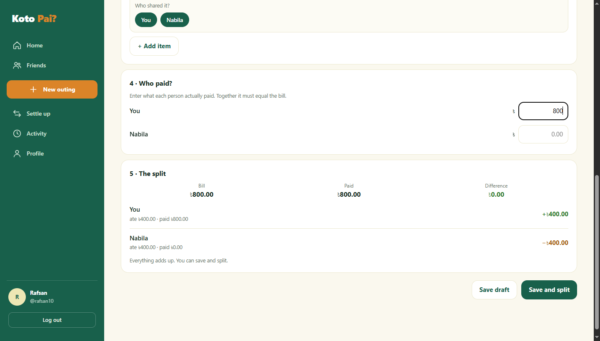

### 2.2 The split engine

The engine is plain Java with no Spring and no JPA. It is a pipeline:

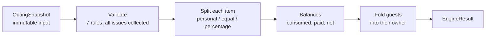

- **Exact allocation.** `100.00 / 3` as three rounded shares is `33.33 × 3 = 99.99`, and a poisha vanishes. The
  *largest remainder* method gives every share its whole poisha, then hands the leftovers to the largest fractions, so
  shares always sum to the original amount.
- **Validation rules** (each is a class): at least one participant, bill not empty, participants known, guest owner
  present, every item has a consumer, shares sum to 100%, **paid equals the bill**.
- **Guest folding.** A guest's net is added to the owner's net, so debts only ever exist between real users.

### 2.3 Ledger and settlement

When an outing is submitted, the ledger turns the engine's nets into debts in the **same database transaction**.

| Capability | How it behaves |
|---|---|
| Balances | Per-friend totals plus a net figure on the dashboard |
| Payments | Debtor records a payment (`PENDING_CONFIRMATION`); the creditor confirms it; partial payments are supported |
| Disputes | A disputed debt stops counting towards balances until resolved |
| Delegation ("skip a step") | If A owes B and B owes C, the middleman can settle A → C directly, reversibly, between mutual friends |
| Simplification | A greedy simplifier proposes at most *n − 1* transfers |
| Guest debts | The guest's owner settles them |
| Concurrency | Optimistic locking: two simultaneous ৳60 payments against a ৳100 debt result in exactly one success and ৳40 remaining |

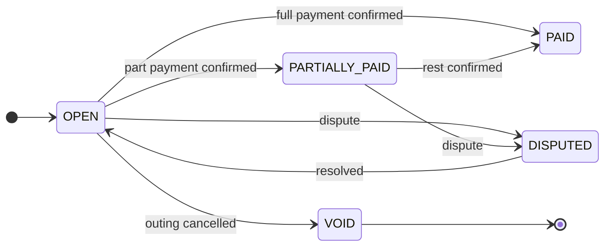

Debt states are a `DebtStatus` enum that owns its legal transitions (State pattern). Cancelling an outing voids its
debts from *any* state, and a disputed debt does not count towards balances.

<table>
  <tr>
    <td>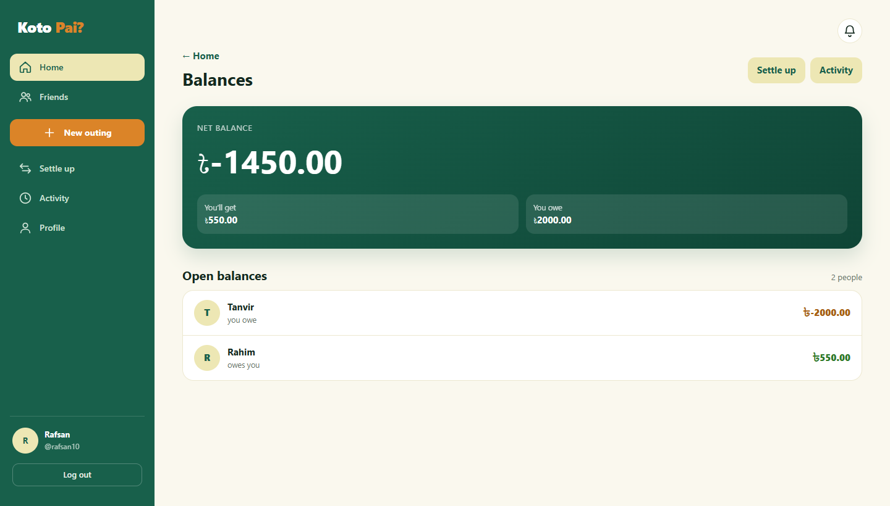</td>
    <td>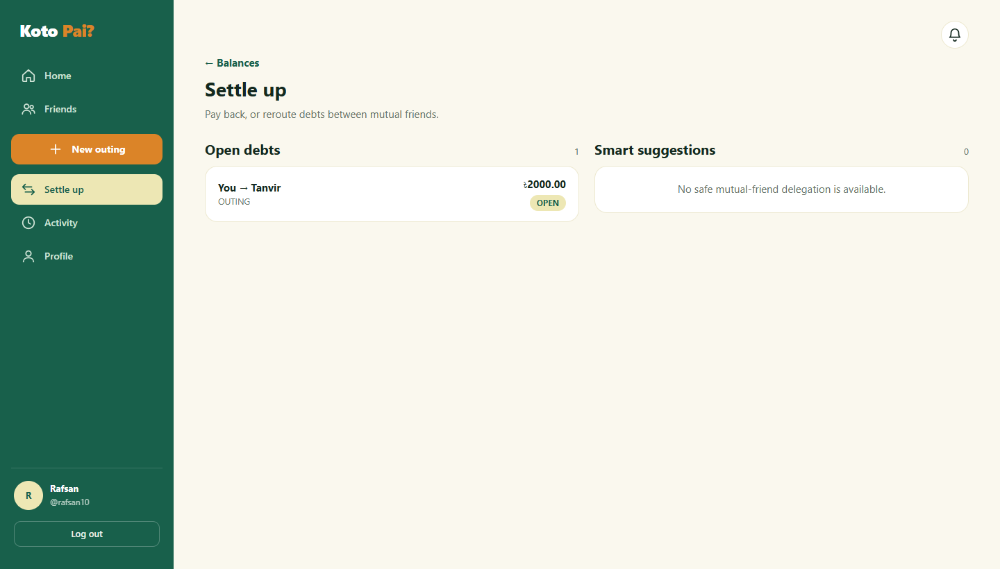</td>
  </tr>
  <tr>
    <td align="center">Balances per friend</td>
    <td align="center">Settle up: payments, disputes, delegation</td>
  </tr>
</table>

### 2.4 Friends, notifications and activity

Friends are added by public user ID (request, accept, reject, remove). Notifications (bell and page) and the activity
timeline are driven by **domain events**: they react to what happened in the outing and ledger modules without those
modules knowing they exist.

<table>
  <tr>
    <td>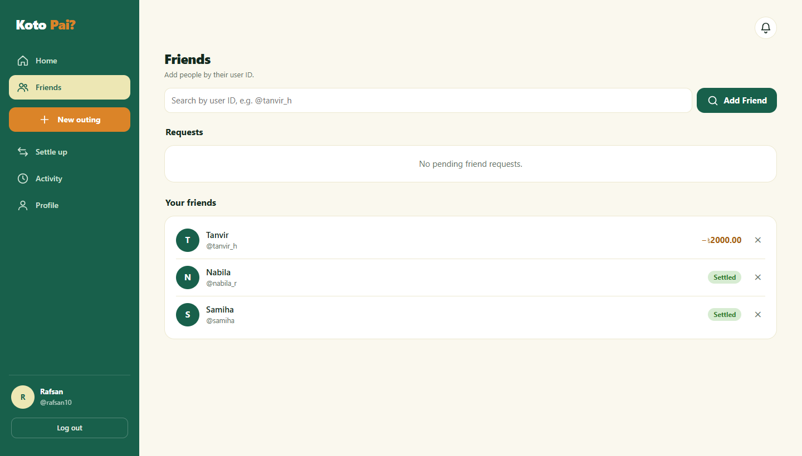</td>
    <td>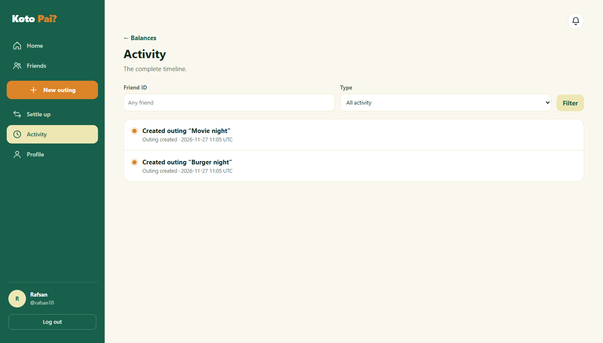</td>
  </tr>
  <tr>
    <td align="center">Friends</td>
    <td align="center">Activity timeline with filters</td>
  </tr>
</table>

### 2.5 Accounts, roles and admin

Registration (with confirm-password), login and profile. Two roles: `USER` and `ADMIN`. The admin console shows
platform statistics, lists users and changes roles; everyone else gets a friendly 403 page.

<table>
  <tr>
    <td>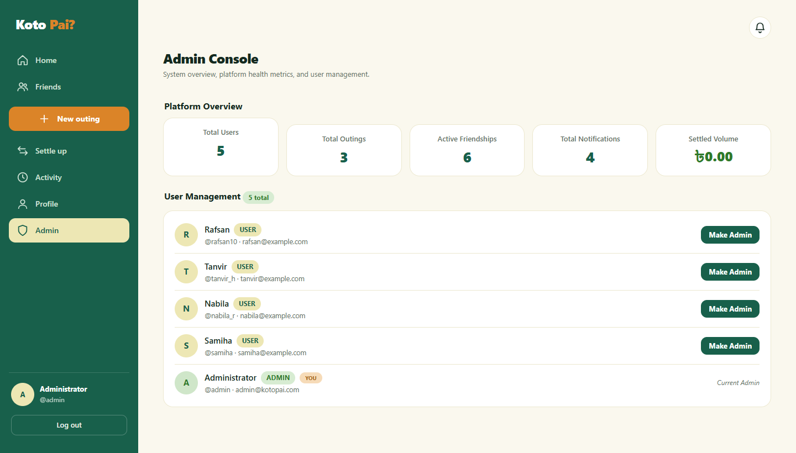</td>
    <td>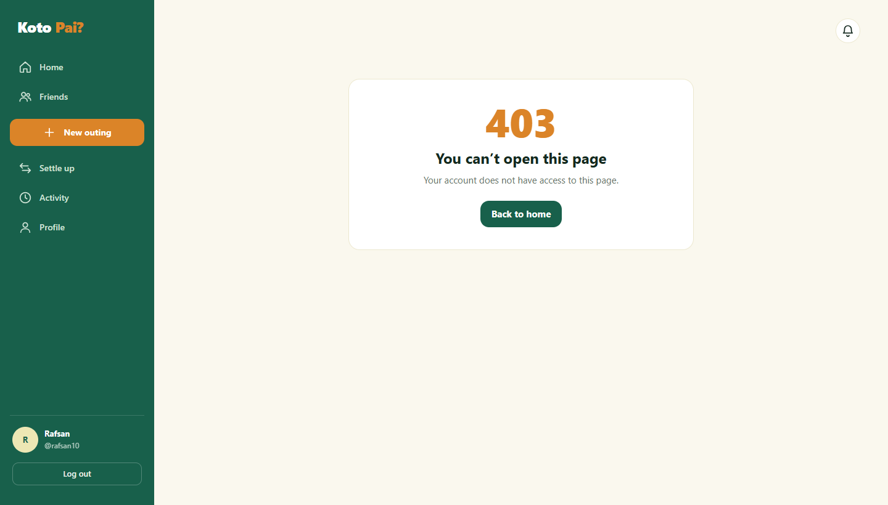</td>
  </tr>
  <tr>
    <td align="center">Admin console (ROLE_ADMIN)</td>
    <td align="center">A normal user opening <code>/admin</code></td>
  </tr>
</table>

### 2.6 Responsive on every screen

One layout adapts from desktop (sidebar) to tablet to phone (bottom tab bar). Signed-out visitors get a public layout
without app navigation.

<table>
  <tr>
    <td>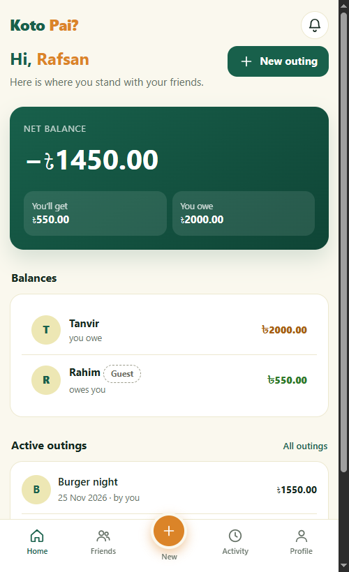</td>
    <td>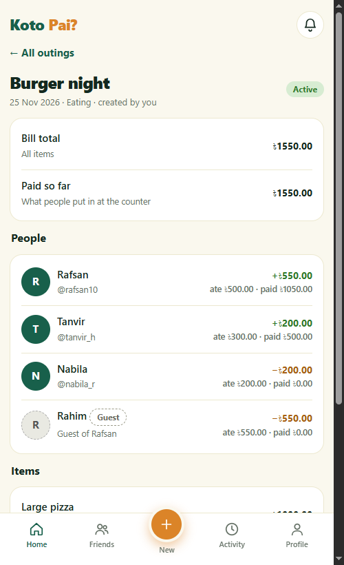</td>
    <td>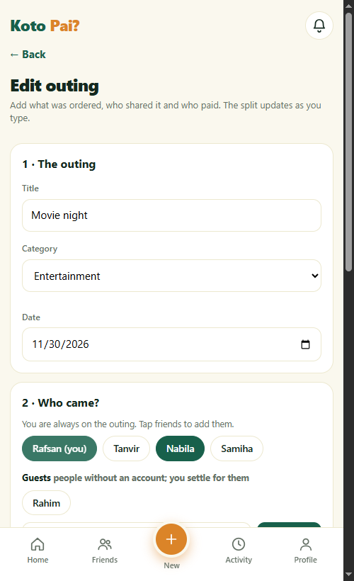</td>
    <td>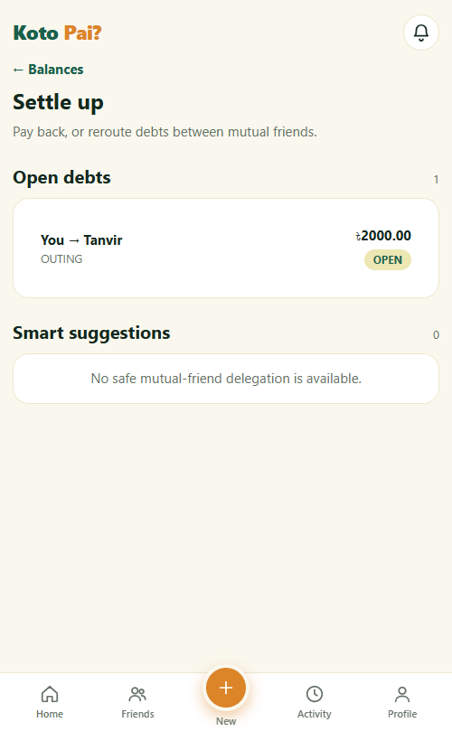</td>
  </tr>
</table>

<details>
<summary>More screens: landing page and outing detail</summary>

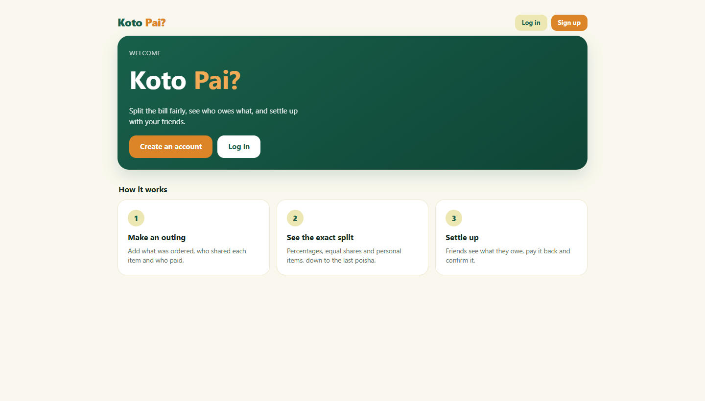

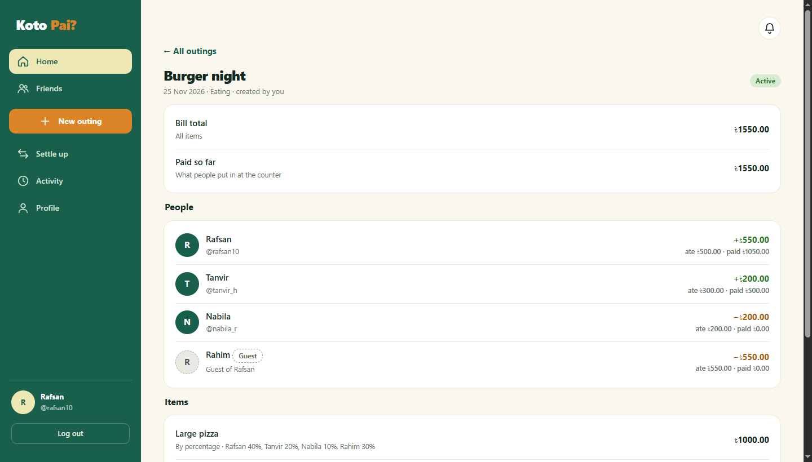

</details>

---

## 3. Architecture

### 3.1 Design goals

| Goal | What it meant in practice |
|---|---|
| **Money must be exactly right** | Pure, heavily tested calculation core; one `Money` type; golden and randomised tests |
| **Three people, one codebase** | Modules agree on contracts (events, ports) up front and build in parallel |
| **Testable at every level** | Core has no framework; adapters are thin; integration tests drive the real filter chain |
| **Operable** | Health probes, metrics, containers, automated pipeline, one-command local start |

### 3.2 System context

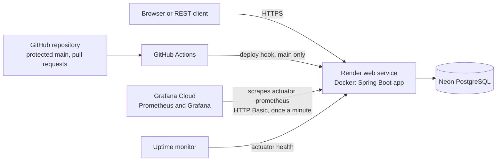

### 3.3 Application architecture: a modular monolith

One deployable, several feature packages with strict boundaries. Modules cooperate through **services, ports and
events**, so any of them could later become its own service.

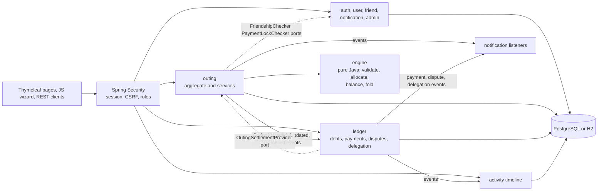

**Inside each feature package** requests flow `controller` (pages) or `api` (REST) → `service` or `facade` →
`repository` → `domain`, with DTOs at the edges. Open-session-in-view is **off** on purpose: pages and facades map to
view models inside read-only transactions, so a lazy-loading surprise cannot happen in a template.

**Boundary rules, and how honestly they hold:**

| Rule | Status |
|---|---|
| The engine imports no Spring and no JPA | Enforced by structure: zero framework imports under `outing/engine` |
| Outing, ledger and activity never touch each other's entities or repositories | Hold. The ledger asks for outing data through the `OutingSettlementProvider` port and links by id |
| Cross-module reactions go through events | Outing publishes `OutingActivated/Updated/Cancelled`; ledger, notifications and activity listen |
| Outing needs friendship, payment-lock and current-user facts | It declares its own narrow ports; adapters in the owning modules implement them |
| Read-only views (admin statistics, profile summary, home dashboard, notification text, name lookup, demo seeding) | **Exception:** these read other modules' repositories directly. They write nothing; see [future work](#14-limitations-and-future-work) |

### 3.4 Package layout (`com.kotopai`)

| Package | Responsibility |
|---|---|
| `common` | `Money`, event types, exceptions, web helpers |
| `auth`, `user`, `friend`, `notification`, `admin` | accounts, identity, friendships, notifications, admin console |
| `outing` | outing aggregate, services, REST + pages; contains `engine` (`allocation`, `split`, `validation`, `balance`, `model`) |
| `ledger` | debts, payments, disputes, delegation, guest debts, simplifier |
| `activity` | timeline and per-friend history |
| `home` | dashboard facade |

About 210 production classes and 100 test classes.

### 3.5 Key flows

**Submitting an outing** — the heart of the system:

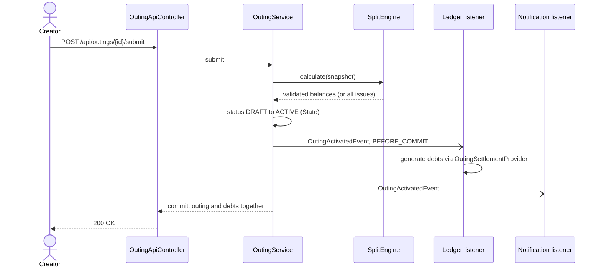

**Settling:** debtor `POST /api/debts/{id}/payments` (pending) → creditor `POST /api/payments/{id}/confirm` → debt
`PARTIALLY_PAID` or `PAID` → outing `SETTLED` when every debt is paid.

---

## 4. Data model

14 tables: `users`, `friendships`, `guests`, `outings`, `outing_participants`, `items`, `item_shares`,
`contributions`, `debts`, `payments`, `delegations`, `guest_debts`, `notifications`, `activity_events`.

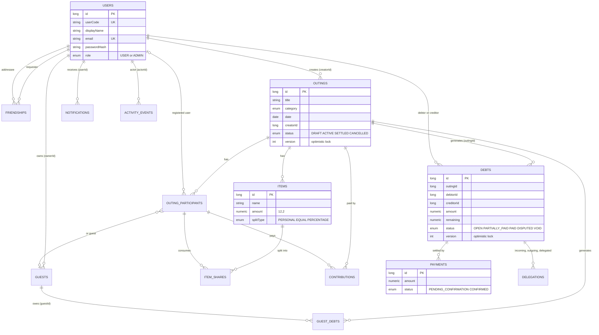

### Relationship types

| Kind | Where |
|---|---|
| **One-to-many with cascade** | `Outing → OutingParticipant`, `Item`, `Contribution`; `Item → ItemShare` (`cascade = ALL`, `orphanRemoval`; children are created only through the aggregate root) |
| **Many-to-one (JPA `@ManyToOne`)** | `OutingParticipant → Outing / Guest`, `Item → Outing`, `ItemShare → Item / OutingParticipant`, `Contribution → Outing / OutingParticipant`, `Payment → Debt`, `Friendship → User` (requester, addressee) |
| **Many-to-many through a junction entity** | `User ↔ User` via `Friendship` (carries status); `Item ↔ OutingParticipant` via `ItemShare` (carries the percentage); `Outing ↔ (User or Guest)` via `OutingParticipant` |
| **Logical id references, no foreign key** | Links *between modules*: `Outing.creatorId`, `Guest.ownerId`, `Debt.outingId / debtorId / creditorId`, `Delegation.*Id`, `GuestDebt.*Id`, `Notification.userId`, `ActivityEvent.*Id` |

**Why ids across modules ([decision D30](#7-design-decisions)):** the ledger, notification and activity modules never
import `User` or `Outing` entities, so each can be built, tested and changed alone. The trade-off is explicit:
referential integrity *between* modules is enforced in services, not by database foreign keys; *inside* an aggregate it
is enforced by JPA relationships.

**Integrity rules:** unique `userCode` and `email`; one friendship per pair; `amount NUMERIC(12,2)`; optimistic
locking (`@Version`) on `Outing` and `Debt`.

---

## 5. REST API

**Conventions**

- Authentication is the session cookie from form login; every state-changing request needs a CSRF token.
- Unauthenticated `/api/**` calls return **401** (pages redirect to `/login` instead).
- Errors are [RFC 9457](https://www.rfc-editor.org/rfc/rfc9457) problem-details JSON: `400` invalid input,
  `401`, `403`, `404` (also used for resources you may not see, so existence does not leak), `409` illegal state
  or conflict, `422` outing cannot be calculated yet.
- The API never accepts a user id from the client: the acting user always comes from the authenticated principal.

**38 endpoints in 11 controllers**

| Area | Endpoint | Purpose | Access |
|---|---|---|---|
| Auth | `POST /api/auth/register` | create an account (201, 409 duplicate, 400 invalid) | public |
| Profile | `GET /api/me`, `PUT /api/me` | read or update own profile | login |
| | `GET /api/users/{userCode}` | public user card | login |
| Friends | `GET /api/friends` | my friends | login |
| | `GET /api/friends/requests`, `POST /api/friends/requests` | incoming requests, send by user code | login |
| | `POST /api/friends/requests/{id}/accept`, `…/reject` | answer a request | addressee |
| | `DELETE /api/friends/{friendId}` | remove a friend | login |
| Guests | `GET /api/guests`, `POST /api/guests`, `DELETE /api/guests/{id}` | my guests (delete refused if used: 409) | owner |
| Outings | `POST /api/outings` | create a draft (201 + `Location`) | login |
| | `GET /api/outings`, `GET /api/outings/{id}` | list, read (hidden = 404) | creator; participants once not draft |
| | `PUT /api/outings/{id}` | replace participants, items, shares, payments | creator; locked after a payment |
| | `POST /api/outings/preview` | engine dry run, nothing saved | login |
| | `POST /api/outings/{id}/submit`, `…/cancel` | lifecycle (409 illegal, 422 invalid) | creator |
| | `DELETE /api/outings/{id}` | delete a draft | creator |
| Ledger | `GET /api/ledger`, `GET /api/debts` | balances per counterparty, my debts | current user |
| Settlement | `POST /api/debts/{debtId}/payments` | record a payment (pending) | debtor or creditor |
| | `POST /api/payments/{paymentId}/confirm` | confirm a payment | creditor |
| | `POST /api/debts/{debtId}/dispute` | dispute with a reason | debtor or creditor |
| Guest debts | `GET /api/guest-debts`, `POST /api/guest-debts/{id}/settle` | list, settle | guest owner |
| Delegation | `GET /api/delegations/suggestions`, `POST /api/delegations` | suggestions, execute | middleman |
| Notifications | `GET /api/notifications`, `GET …/unread-count`, `POST …/{id}/read`, `POST …/read-all` | my notifications | owner |
| Activity | `GET /api/activity` (`friendId`, `type` filters) | timeline | current user |
| Admin | `GET /api/admin/stats`, `GET /api/admin/users`, `POST /api/admin/users/{id}/role` | console | **ROLE_ADMIN** |
| Operations | `GET /actuator/health` (+ `/liveness`, `/readiness`) | probes | public |
| | `GET /actuator/prometheus` | metrics | HTTP Basic, scrape account only |

Server-rendered pages sit beside the API: `/`, `/login`, `/register`, `/friends`, `/outings` (+ `new`, `{id}`, `edit`),
`/ledger`, `/settle`, `/activity`, `/notifications`, `/profile`, `/admin`.

**Example: preview a split without saving anything**

```http
POST /api/outings/preview
Content-Type: application/json
X-CSRF-TOKEN: …

{
  "participants": [ { "userId": 1 }, { "userId": 2 } ],
  "items": [
    { "name": "Dinner", "amount": 800.00, "splitType": "EQUAL",
      "shares": [ { "participant": { "userId": 1 } }, { "participant": { "userId": 2 } } ] }
  ],
  "contributions": [ { "participant": { "userId": 1 }, "amount": 800.00 } ]
}
```

```json
{
  "valid": true,
  "issues": [],
  "billTotal": 800.00,
  "paidTotal": 800.00,
  "balances": [
    { "userId": 1, "guestId": null, "consumed": 400.00, "paid": 800.00, "net": 400.00 },
    { "userId": 2, "guestId": null, "consumed": 400.00, "paid": 0.00,   "net": -400.00 }
  ],
  "userNets": [ { "userId": 1, "net": 400.00 }, { "userId": 2, "net": -400.00 } ]
}
```

Incomplete input is still a normal `200` with `"valid": false` and **every** problem in `issues` (for example
`NO_ITEMS` and `PAID_NOT_EQUAL_BILL` together), which is what lets the wizard show all errors at once.

---

## 6. Software design: patterns and principles

Patterns here are tools, used where behaviour varies or where a rule must live in exactly one place. Each row says
what problem it solves and what would go wrong without it.

### 6.1 Pattern register

| Pattern | Where | Problem it solves |
|---|---|---|
| **Value Object** | `common/money/Money` | One immutable, scale-2, HALF_EVEN money type. Raw `BigDecimal` treats `2.0` and `2.00` as different; `double` corrupts a ledger |
| **Strategy** | `outing/engine/split/SplitStrategy` with `SoleConsumer`, `Equal`, `Percentage` | Split rules vary independently; no growing `switch` |
| **Template Method** | `AbstractSplitStrategy` | Common checks run once in a `final` method, so no strategy can forget the duplicate-consumer check |
| **Factory (registry)** | `SplitStrategyFactory` | One place maps split type to strategy; a missing or duplicate strategy fails at startup |
| **Builder** | `OutingSnapshot.Builder` | Readable construction of an immutable snapshot; short test fixtures |
| **Chain of Responsibility** (collecting variant) | `validation/ValidationRule` and 7 rules | Every problem is reported at once; a new rule is a new class |
| **Facade** | `SplitEngine`, `OutingApiFacade`, `OutingPageFacade`, `HomePageFacade`, `SettlementFacade` | One entry point; callers cannot skip validation; DTO mapping happens inside the transaction |
| **Aggregate Root (DDD)** | `Outing` | Rules live in one place; children are saved and deleted with it |
| **Repository** | `*Repository` | Queries behind intention-revealing methods; visibility rules inside the query |
| **State** | `OutingStatus`, `DebtStatus` | Legal transitions are defined once, not scattered through `if` checks |
| **Adapter** | `OutingSnapshotMapper`, `EngineSettlementProvider`, `LedgerPaymentLockChecker`, `SecurityContextCurrentUser` | Keeps the engine free of JPA and joins modules without importing each other |
| **Ports and Adapters / Dependency Inversion** | `outing/port/*`, `ledger/spi/*` | Modules build and test before their neighbours exist |
| **Observer** (Spring events) | `Outing*Event`, ledger / notification / activity listeners | Outing does not know the ledger, notifications or the timeline exist |
| **DTO** | `outing/api/dto`, ledger DTOs | Entities never reach JSON; clients cannot over-post fields such as `status` |
| **Authorization policy object** | `OutingAccessPolicy` | One place decides who may view or edit; answers 404 instead of 403 to avoid leaking existence |
| **Optimistic locking** | `@Version` on `Outing`, `Debt` | Concurrent edits cannot silently overwrite each other |
| **Separate security filter chain** | `MetricsSecurityConfig` | A machine account for Prometheus cannot reach the application |

### 6.2 Four patterns, in code

**Strategy + Template Method + Factory — the split rules.** The base class owns the checks, subclasses own only the
arithmetic, and the factory guarantees every `SplitType` has exactly one strategy.

```java
public abstract class AbstractSplitStrategy implements SplitStrategy {

    @Override
    public final Map<ParticipantRef, Money> split(ItemLine item) {
        // checks every strategy needs: right type, at least one consumer, no duplicates
        ...
        return Collections.unmodifiableMap(doSplit(item));      // strategy-specific part
    }

    protected abstract Map<ParticipantRef, Money> doSplit(ItemLine item);
}
```

```java
public SplitStrategyFactory(Collection<? extends SplitStrategy> strategies) {
    ...                                          // two strategies for one type -> IllegalStateException
    Set<SplitType> missing = EnumSet.allOf(SplitType.class);
    missing.removeAll(this.strategies.keySet());
    if (!missing.isEmpty()) {
        throw new IllegalStateException("no strategy registered for " + missing);
    }
}
```

*Open/Closed in action:* adding an "exact amounts" split means one new strategy and one enum value. Forgetting the
strategy breaks startup and a test, not a customer's bill.

**Chain of Responsibility (collecting) + Facade — validation and the engine door.**

```java
// SnapshotValidator: run every rule, never stop at the first problem
for (ValidationRule rule : rules) {
    issues.addAll(rule.check(snapshot));
}

// SplitEngine: the only entry point; validation cannot be skipped
public EngineResult calculate(OutingSnapshot snapshot) {
    validator.validateOrThrow(snapshot);
    List<ParticipantBalance> balances = calculator.calculate(snapshot);
    return new EngineResult(snapshot.billTotal(), balances, guestFolder.fold(balances));
}
```

**State — the outing lifecycle.** Each status decides which actions are legal; anything else throws
`IllegalOutingTransitionException`, which the API maps to `409`.

```java
public enum OutingStatus {
    DRAFT  { submit() -> ACTIVE;  cancel() -> CANCELLED;  canEdit(...) -> true },
    ACTIVE { cancel() -> CANCELLED;  markSettled() -> SETTLED;
             canEdit(paymentRecorded) -> !paymentRecorded },
    SETTLED, CANCELLED;              // final: every action throws
}
```

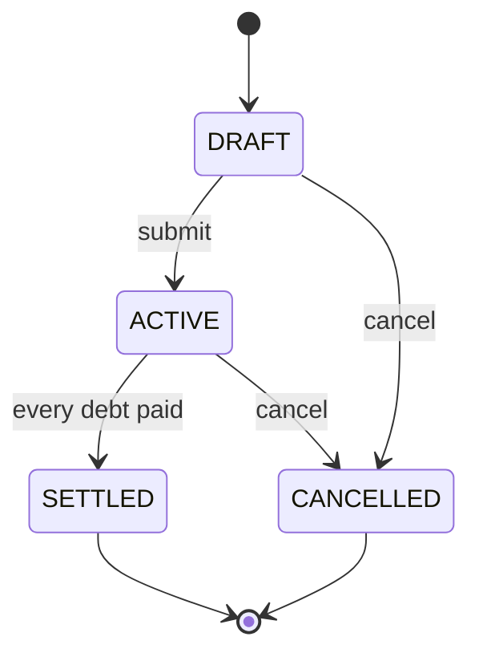

**Observer + Ports — modules that do not know each other.** The outing service publishes an event; the ledger reacts.

```java
@TransactionalEventListener(phase = TransactionPhase.BEFORE_COMMIT, fallbackExecution = true)
public void onOutingActivated(OutingActivatedEvent event) {
    debts.generateDebts(event.outingId());
}
```

`BEFORE_COMMIT` is deliberate ([D16](#7-design-decisions)): the first version listened `AFTER_COMMIT`, and an
integration test caught an active outing with **zero debts**, because writes made after the commit were silently lost.
Now the outing and its debts commit or roll back together.

### 6.3 Design principles

| Principle | Where you can see it |
|---|---|
| **Single Responsibility** | One validation rule per class; thin controllers → facade → service; `PersonNames` only resolves names |
| **Open / Closed** | New split type = new strategy; new rule = new class; new reaction to an outing event = new listener, no edit to `OutingService` |
| **Liskov Substitution** | Every strategy honours the template contract; the calculator depends only on the interface |
| **Interface Segregation** | Narrow ports (`FriendshipChecker.areFriends`, `PaymentLockChecker.hasRecordedPayments`, `CurrentUserProvider`) instead of whole services |
| **Dependency Inversion** | Outing depends on its own ports; adapters bind to other modules; the engine depends on nothing |
| **DRY** | One layout fragment for every page; shared test fixtures; one CSS design system |
| **Encapsulation and immutability** | Records and defensive copies in the engine; state changes only through aggregate methods |
| **Fail fast** | Factory completeness check, `Money` rejects 3 decimals, health probes at startup |
| **Separation of concerns** | Pure engine, persistence and web are separate; view models instead of entities in templates |
| **Least privilege / defence in depth** | Checks in services *and* URL rules; separate metrics chain; non-root container; secrets from the environment |
| **KISS / YAGNI** | Plain JavaScript instead of a framework; a rule that could never fire was deleted; no soft-delete |

**Clean code:** package by feature, names from the domain (`consumed`, `paid`, `net`, `poisha`), Javadoc that explains
*why*, records for data, no `double` for money.

---

## 7. Design decisions

Each decision records the alternative and the reason. The first ten shaped the architecture; the rest are in the
expandable list.

| # | Decision | Over | Because |
|---|---|---|---|
| D1 | Calculation engine is pure Java | A Spring service working on entities | Fast, deterministic tests; reused by preview, submit and ledger |
| D2 | Largest-remainder allocation in poisha | Rounding each share | `100 / 3` would lose a poisha; shares must sum exactly |
| D3 | Validation collects all errors | Fail on the first | The wizard shows every problem at once |
| D16 | Debts generated `BEFORE_COMMIT` in the same transaction | `AFTER_COMMIT` | After commit the ledger writes were silently lost; atomic commit and rollback |
| D5 | Wizard saves each step into the DRAFT outing | HTTP session state | Survives refresh and back; simpler to test |
| D6 | Ports with stubs between modules | Waiting for teammates | Parallel work and clean seams |
| D17 | Session form login, CSRF on, `/api/**` returns 401 | JWT | One consistent model for pages and API |
| D30 | Cross-module links are ids, not JPA joins | `@ManyToOne` everywhere | Module independence; foreign keys only inside aggregates |
| D18 | Render (Docker) + Neon PostgreSQL | Railway, Fly.io, Koyeb | Free tiers, reuses the Dockerfile, deploy hook for CI, separate managed database |
| D21 | `/actuator/prometheus` behind HTTP Basic on its own filter chain, closed when no password is set | Public, or form login | Prometheus cannot fill a login form; safe by default |

<details>
<summary><b>All other decisions</b></summary>

| # | Decision | Over | Because |
|---|---|---|---|
| D7 | Separate unit (`*Test`, Surefire) and integration (`*IT`, Failsafe) phases with a `skipUTs` switch | One `mvn test` | Two independent CI checks; fast feedback |
| D8 | `Money.of` rejects more than 2 decimals | Silently rounding input | User input must never change unnoticed |
| D9 | Builder checks structure only | Builder throws on every rule | The validator can list all issues |
| D10 | Reuse the ledger's event types for now | Move them to `common.events` first | Zero rework; the move is a mechanical rename |
| D11 | Replace a rule that could never fire with `BillNotEmptyRule` and `GuestOwnerPresentRule` | Keep dead rules | Negatives are already refused at construction |
| D12 | No second `NetPosition` type in the engine | Duplicating the ledger's class | `EngineResult.folded()` is the contract; an adapter maps |
| D13 | Reject duplicate guest names per owner | Allow | Indistinguishable guests risk wrong assignment |
| D14 | A guest used in an outing cannot be deleted | Soft-delete | Their consumption is part of a bill; simplest correct rule |
| D15 | Real `LedgerPaymentLockChecker` right away | A stub for later | The service existed; same cost |
| D19 | Compose defaults to `prod,demo`; a real deployment may use plain `prod` | `prod` only | A fresh stack has accounts to demo with |
| D20 | Only `/actuator/health` is public | Open all or close all | Probes work without login; internals stay private |
| D22 | Scrape password from an environment variable, written to a `password_file` at start | Password in `prometheus.yml` | No secrets in git |
| D23 | Docker build uses a Maven image, a Google mirror of Maven Central and retries; unit tests skipped in the image build | Maven wrapper, plain Central | Central returned HTTP 429 to the host's shared IPs; tests already run in CI |
| D24 | CI deploys via the Render deploy hook, only on `main`, after all checks; Render auto-deploy off | Render auto-deploy on push | One gate for production |
| D25 | Monitoring as code: Compose profile plus Grafana Cloud; dashboard JSON versioned | Dashboards clicked together | Reproducible and reviewable |
| D26 | Signed-out visitors get a public layout; `/` and `/error` are public | Redirect `/` to login | Avoids dead links and a post-login raw-error page |
| D27 | Centred 1180 px content, two columns from 1200 px, tablet and phone rules | Fixed narrow column | Use the space properly on every device |
| D28 | `PersonNames` bean for display names in templates | Changing every controller | Tiny, testable, fallback "Someone" |
| D29 | Confirm-password checked in the web controller | Adding a field to `RegisterRequest` | REST contract and its tests unaffected |
| D31 | Roles `USER` and `ADMIN` | Seller / buyer roles | The domain has no seller or buyer concept |
| D32 | Source level stays Java 17 while CI and Docker run 21 | Raising to 21 | Teammates on JDK 17 would break; tried and reverted |
| D33 | `ddl-auto=update`, H2 for tests, PostgreSQL for production | Flyway or Liquibase | Speed for a course project; the risk is listed under limitations |
| D34 | Hosted dashboard uses 5-minute rate windows | 1 minute | Grafana Cloud scrapes every minute; `rate()` needs two samples |
| D35 | Branded error page for 401/403/404/5xx without internals | Spring's Whitelabel page | Looks intentional; four tests prove nothing internal leaks |
| D36 | 5xx tile shows `0` when there are no errors (`or vector(0)`) | "No data" | An absent series is not a broken panel |

</details>

---

## 8. Security

| Area | What is implemented |
|---|---|
| **Authentication** | Spring Security form login, session cookie, logout; passwords hashed with **BCrypt** (a test proves the stored hash differs from the password); login by user ID or e-mail |
| **Authorization (RBAC)** | Roles `USER` and `ADMIN` mapped to `ROLE_*`. `/admin/**` and `/api/admin/**` require `ROLE_ADMIN`; `@EnableMethodSecurity` with `@PreAuthorize("hasRole('ADMIN')")` on the admin service; everything else is authenticated by default |
| **Resource-level checks** | Outings are visible to the creator and, once submitted, participants (hidden and unknown both return 404). Debts: debtor and creditor only. Payments: only the creditor confirms. Guest debts: owner only. Delegation: only the middleman between mutual friends. Ledger and activity reads are scoped to the authenticated user |
| **CSRF** | Enabled for every state-changing request; tests prove a POST without a token is rejected and one with a token succeeds |
| **Input validation** | Bean Validation on every request DTO (`@NotBlank`, `@Digits(fraction = 2)`, `@DecimalMin`, sizes) plus engine rules for business validation |
| **Concurrency** | `@Version` on `Debt` and `Outing`; proven by a concurrent-payment integration test |
| **Error handling** | `GlobalExceptionHandler` and problem-details handlers; branded error pages with no stack traces or exception names |
| **Operations** | Non-root container user; secrets only from the environment (`.env` is git-ignored, `.env.example` is committed); the Prometheus endpoint has its own Basic-auth filter chain |

**Vulnerabilities found and fixed during the project:** an early home page showed any user's ledger through a
`?userId=` parameter (removed; identity comes only from the principal); a non-public `/error` caused a post-login
redirect to a raw JSON page; a health check behind login reported the container healthy while the app was broken.

---

## 9. Testing

**729 tests: 634 unit and 95 integration, 0 failures.** The requirement was at least 20 and 10; both phases run on
every push in CI. Engine line coverage is **100%** with an **80% gate** enforced by JaCoCo in the pipeline.

| Level | Tooling | What it proves |
|---|---|---|
| **Unit** (`*Test`, Surefire) | JUnit 5, Mockito, AssertJ, `@ParameterizedTest`, `@WebMvcTest`, `@DataJpaTest` | Engine arithmetic, each validation rule, each strategy, state machines, controllers with mocked facades, mappers, policies |
| **Integration** (`*IT`, Failsafe) | `@SpringBootTest`, MockMvc with the real security filter chain, H2 | Whole flows through HTTP, security and the database |

### What the tests are built to catch

- **Golden-master engine tests:** hand-worked scenarios (burger night, guest Rahim) assert exact numbers. 200 seeded
  random cases prove shares always sum exactly and each is within one poisha.
- **Security matrices:** every ledger and activity route is called anonymously and as an unrelated user; outing
  visibility, CSRF, 401/403/404; admin RBAC; the metrics endpoint (401, wrong password, closed when unset, scrape
  account cannot use the app).
- **End-to-end flows:** create → submit → debts → cancel → void; submit → dispute → regenerate → partial payment →
  final payment → settled; two concurrent payments.
- **Integration tests found defects that unit tests could not:** a missing cascade (data not saved although the unit
  test passed), debts silently lost with `AFTER_COMMIT`, guests that would have been counted twice across the module
  contract, and CSRF being checked before authentication.
- **The pipeline demonstrably catches regressions:** an intentional `BigDecimal.equals` bug turned the unit job red and
  skipped integration, then went green after the `compareTo` fix; a missing cascade passed unit tests but failed
  integration on the same commit.
- **Not covered automatically:** the wizard's JavaScript (no JS test framework). It is covered by the API integration
  tests it calls and by the [manual test script](MANUAL_TEST.md).

```powershell
./mvnw verify                  # unit + integration (Windows: .\mvnw.cmd verify)
./mvnw test                    # unit tests and the coverage gate
./mvnw verify -DskipUTs=true   # integration tests only (what CI's integration job runs)
```

---

## 10. CI/CD and Git workflow

### Branching and review

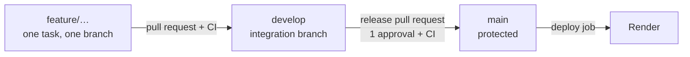

`main` is protected: no direct pushes, changes arrive by pull request with at least one approval and green required
checks. Merge commits are used on purpose so the history, including intentional red commits, stays visible.

### Pipeline (`.github/workflows/ci.yml`)

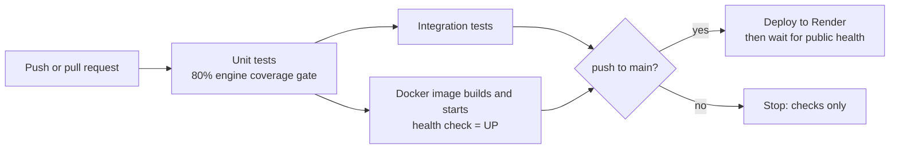

| Job | Runs | What it does |
|---|---|---|
| **Unit tests** | every push and pull request | `./mvnw test` on JDK 21 with the coverage gate; uploads Surefire and JaCoCo reports |
| **Integration tests** | after unit tests | `./mvnw verify -DskipUTs=true` |
| **Docker image builds and starts** | after unit tests | Builds the `Dockerfile`, starts it beside a throw-away PostgreSQL with the `prod` profile and waits for `/actuator/health` to report `UP` |
| **Deploy to Render** | **only pushes to `main`**, after all three pass | Calls the Render deploy hook (repository secret `RENDER_DEPLOY_HOOK_URL`) for that exact commit, then polls the public health check |

Other properties: superseded runs are cancelled, least-privilege `permissions: contents: read`, the integration job
waits for unit tests (fail fast), and Render's own auto-deploy is **off** so only this pipeline can release.

<table>
  <tr>
    <td>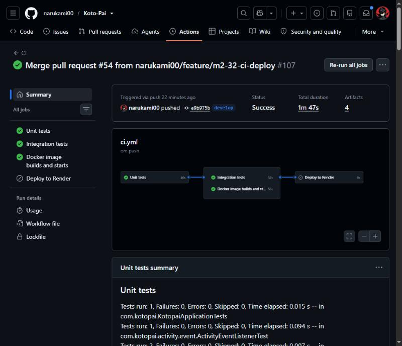</td>
    <td>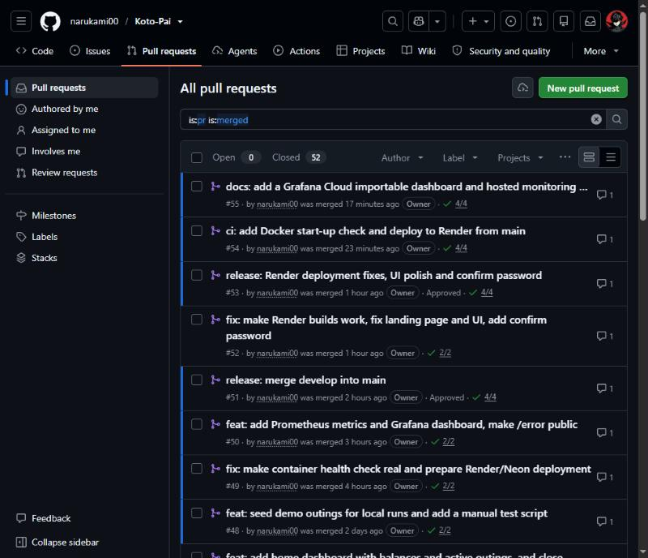</td>
  </tr>
  <tr>
    <td align="center">Job graph (deploy is skipped off <code>main</code> by design)</td>
    <td align="center">One task, one branch, one pull request</td>
  </tr>
</table>

---

## 11. Run it locally

**Prerequisites:** Docker Desktop, or a JDK (17 or newer) for the no-Docker route.

### Option A: Docker Compose (application + PostgreSQL)

```powershell
docker compose up --build
```

Open <http://localhost:8080>. If the port is taken, pick another: `HOST_APP_PORT=8082 docker compose up --build`
(PowerShell: `$env:HOST_APP_PORT = 8082` first). Compose starts with the `demo` profile, so the demo accounts and
three demo outings exist.

| Login | Password | Role |
|---|---|---|
| `rafsan10`, `tanvir_h`, `nabila_r`, `samiha` | `password123` | USER |

There is no demo administrator under Compose. To see the Admin Console, set `KOTOPAI_ADMIN_USER_CODE` to the handle
of an account you registered (it is promoted to ADMIN on start-up; see [`DEPLOYMENT.md`](DEPLOYMENT.md)). Under
Option B below, the in-memory H2 run still seeds `admin` / `password123` for local use only.

### Option B: no Docker (in-memory H2, seeded data)

```powershell
./mvnw spring-boot:run "-Dspring-boot.run.profiles=h2"
```

On Windows PowerShell or cmd use `.\mvnw.cmd` instead of `./mvnw` (here and in [Testing](#9-testing)).
Open <http://localhost:8080> and use the same demo logins.

### Option C: with Prometheus and Grafana

```powershell
docker compose --profile monitoring up -d --build
```

Prometheus is on <http://localhost:9090> and Grafana on <http://localhost:3000> (development defaults
`admin` / `kotopai_grafana`), with the dashboard **Koto Pai - Application Overview** already provisioned.

### Configuration

Everything comes from environment variables, with development-only defaults in Compose and **no secrets in the
repository** (copy `.env.example` to `.env`, which is git-ignored).

| Variable | Purpose |
|---|---|
| `SPRING_PROFILES_ACTIVE` | `prod` (PostgreSQL), add `demo` for demo data, `h2` for in-memory |
| `PORT` | listen port (hosting platforms set it) |
| `DB_HOST`, `DB_PORT`, `DB_NAME`, `DB_USER`, `DB_PASSWORD`, `DB_SSLMODE` | PostgreSQL connection |
| `METRICS_USER`, `METRICS_PASSWORD` | scrape account for `/actuator/prometheus`; metrics stay closed when the password is empty |

The full list, standalone `docker run`, and platform notes are in the **[Deployment guide](DEPLOYMENT.md)**.

---

## 12. Docker, hosting and monitoring

### 12.1 Docker image (`Dockerfile`)

| Stage | Base | Purpose |
|---|---|---|
| `builder` | `maven:3.9-eclipse-temurin-21-alpine` | Copies `pom.xml` first for layer caching, resolves dependencies through a Maven Central mirror with retries, packages the jar without re-running unit tests |
| `extractor` | `eclipse-temurin:21-jre-alpine` | Extracts the Spring Boot **layered jar** (dependencies change rarely, application code often) |
| `runner` | `eclipse-temurin:21-jre-alpine` | **Non-root** user `kotopai`, layers copied in change-frequency order, `HEALTHCHECK` that requires `"status":"UP"`, container-aware JVM memory settings, honours `PORT` |

`docker-compose.yml` runs `postgres:16-alpine` (health check, persistent volume) and the app (starts only when the
database is healthy). The optional `monitoring` profile adds Prometheus and Grafana, provisioned from `monitoring/`.

### 12.2 Where it is hosted

| Part | Where | Notes |
|---|---|---|
| Application | **Render**: Docker web service, free tier | Built from the repository `Dockerfile`; health check path `/actuator/health`; auto-deploy off, CI triggers releases |
| Database | **Neon** PostgreSQL | SSL required (`DB_SSLMODE=require`), direct host, same region as the service |
| CI/CD | **GitHub Actions** | See [section 10](#10-cicd-and-git-workflow) |
| Monitoring | **Grafana Cloud** | Scrapes the app once a minute |
| Live URL | <https://koto-pai-aatd.onrender.com> | Free instances sleep after about 15 minutes idle and need about a minute to wake |

<table>
  <tr>
    <td>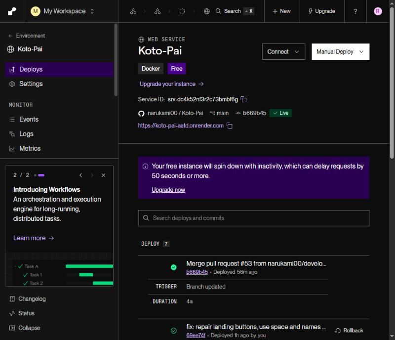</td>
    <td>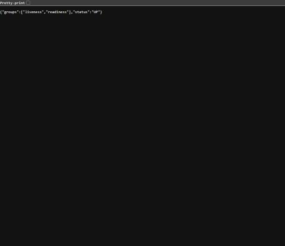</td>
  </tr>
  <tr>
    <td align="center">Render service and deploy history</td>
    <td align="center"><code>/actuator/health</code> on the live URL</td>
  </tr>
</table>

### 12.3 Monitoring and observability

- **Actuator:** `/actuator/health` (with liveness and readiness probes) is public; `info` and `metrics` need login.
- **Micrometer → Prometheus:** `/actuator/prometheus` is protected by HTTP Basic on a **separate filter chain**, closed
  entirely when no password is configured. Metrics carry the tag `application=kotopai`, and latency histograms give
  p50, p95 and p99.
- **Dashboard "Koto Pai - Application Overview"** (12 panels, versioned as JSON): app status, uptime, requests per
  second, 5xx rate, heap, live threads, requests by status, response-time percentiles, latency by endpoint, JVM memory,
  HikariCP connection pool, CPU.
- **Three ways to view it:** the local Compose profile, a laptop-hosted stack pointed at the live site
  (`docker-compose.live-monitoring.yml`), and a **hosted Grafana Cloud** dashboard that stays up without anyone's laptop
  (`monitoring/grafana-cloud/kotopai-dashboard.json`). Setup steps are in the [Deployment guide](DEPLOYMENT.md).

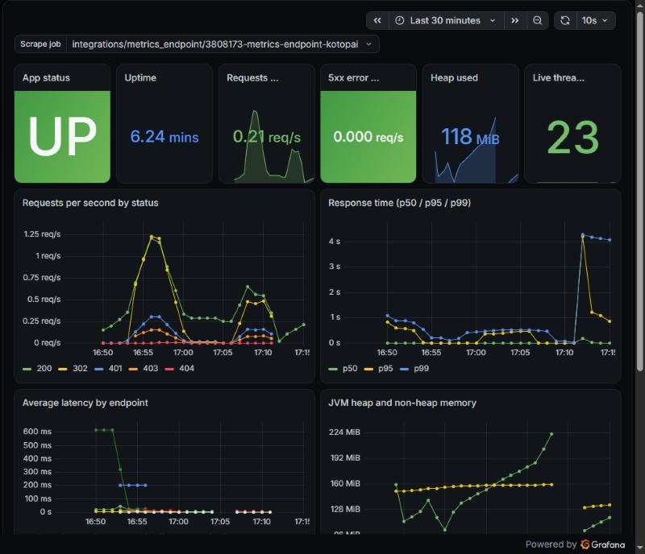

<details>
<summary>More monitoring screenshots</summary>

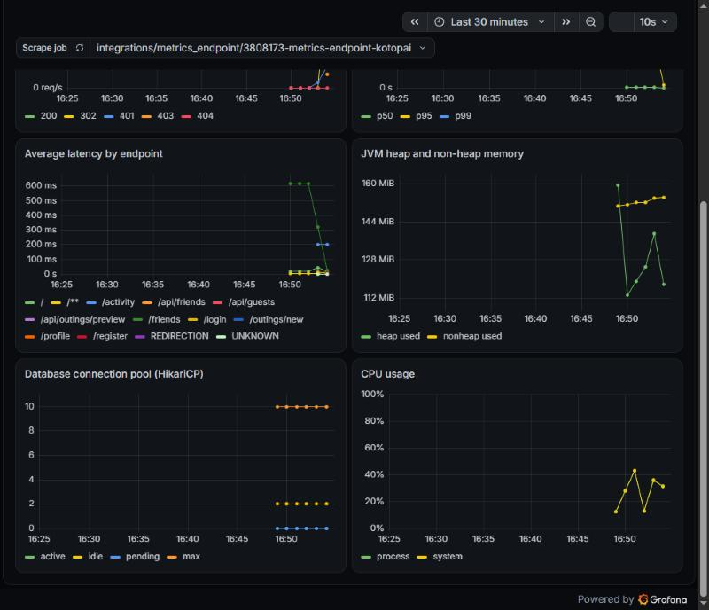

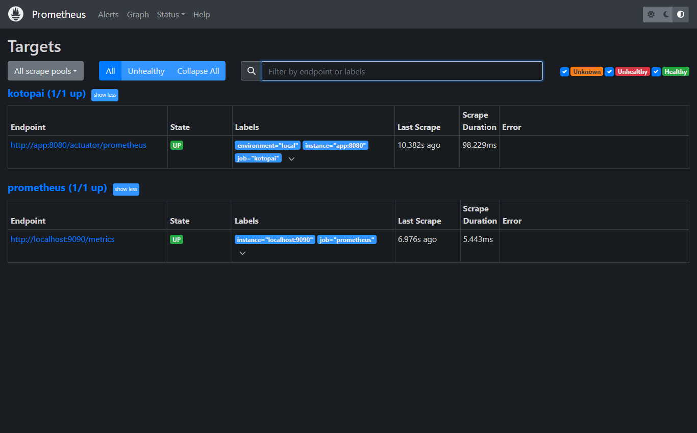

</details>

---

## 13. Project management and team

### 13.1 How the work was run

- **Incremental delivery:** a written roadmap of numbered tasks, each with a definition of done, delivered in short
  cycles of one to three tasks per day.
- **One task = one branch = one pull request**, with unit **and** integration tests alongside the code.
- **A per-task work log** recorded what was built, which concept it applied, which files changed, which tests ran,
  and which decisions were taken.
- **Contracts first:** the cross-module interfaces (events, `OutingSettlementProvider`, `DebtService`,
  `NotificationService`, `FriendService`) were agreed in an architecture document before parallel work started. A
  module could build against a port with a stub before its neighbour existed, then drop the stub once the real one
  merged.
- **Integration checkpoints:** the three modules were reconciled on `develop` on scheduled days; each check recorded
  what matched and what had to change (for example the `BEFORE_COMMIT` fix above).
- **Quality gates:** protected `main`, required checks, review approval, coverage gate, Docker start-up check, deploy
  only after everything is green.

### 13.2 Team

Three members, each owning a vertical slice end to end (service, API, pages, tests).

| Member | GitHub | Owned |
|---|---|---|
| **Rafsan Riasat** | [narukami00](https://github.com/narukami00) | `outing` and the split engine, dashboard, demo data, CI, Docker and deployment hardening, monitoring, UI polish |
| **Utsa Roy** | [utsaroy](https://github.com/utsaroy) | `auth`, `user`, `friend`, `notification`, `admin`, `common`, base layout, security hardening |
| **Adib Raian** | [aaddiibb](https://github.com/aaddiibb) | `ledger` (debts, payments, disputes, delegation, guest debts, simplifier), `activity`, ledger and activity pages |

### 13.3 Timeline

| Date (2026) | Milestone |
|---|---|
| Oct 28–31 | Repository, test tooling, CI pipeline, engine core |
| Nov 5–6 | Ledger phases 0–1; engine complete, entities, lifecycle, adapters |
| Nov 14 | Services, domain events, REST API, live preview, integration suite; auth and layout foundation |
| Nov 15–24 | Payments, delegation, friends, profile, notifications, activity; outing pages |
| Nov 25 | Hardening, wizard with live preview, dashboard, demo data |
| Nov 27 | Deployment, monitoring, build fixes, CI deploy job, hosted Grafana |

### 13.4 What went wrong, and what it taught

| Problem | Cause | Lesson |
|---|---|---|
| Valid `100.00` percentages were rejected | `BigDecimal.equals` compares scale (`100` ≠ `100.00`) | Use `compareTo`; realistic test inputs find real bugs |
| Data not saved although the unit test passed | Missing cascade; the test read the same persistence context | A passing unit test is not data in the database; integration tests exist for a reason |
| Submit left an active outing with **0 debts** | `AFTER_COMMIT` listener writes were lost | Cross-module integration tests find contract bugs (D16) |
| Home page leaked any user's ledger | A client-supplied `?userId=` on a public page | Never trust client-supplied identity |
| Container "healthy" while the app was behind login | `curl -f` treats a 302 as success | A health check must check health |
| Render build failed in 0.2 s with HTTP 429 | Maven Central rate-limits shared build IPs | Retries do not fix a block; remove the dependency or use a mirror |
| Unit tests ran inside every image build | `-DskipTests` was ignored; the project wires its own `skipUTs` | Confirm a flag actually takes effect |
| Users without access saw a raw "Whitelabel Error Page" | No error view | Click through the unhappy paths too |
| Dashboard showed "No data" instead of 0 errors | An absent series is not zero | Design the empty state |

---

## 14. Limitations and future work

- **Cross-module references are ids, not foreign keys** ([D30](#7-design-decisions)), and a few read-only views
  (admin statistics, profile summary, dashboard, notification text) read other modules' repositories directly.
  Future work: replace those with small query ports.
- **Schema management:** Hibernate `ddl-auto=update` instead of Flyway or Liquibase ([D33](#7-design-decisions)).
- **Accounts:** no login rate limiting, password reset or e-mail verification. Demo accounts with a known password
  exist on the live site and are removed by running plain `prod` instead of `prod,demo`.
- **Roles:** `USER` and `ADMIN` only; the domain has no seller or buyer concept.
- **Free-tier hosting:** the instance sleeps when idle, so the first request is slow and the first minute after a long
  idle can show a gap in the dashboards.
- **Single instance:** sessions are in memory.
- **Wizard JavaScript** has no automated tests (manual script and API integration tests cover it).
- **Cosmetic:** friend history shows "Outing #2" instead of the outing title; signed-out visitors who open an unknown
  URL are redirected to the login page because the app is authenticated by default.
- **Not done:** a second-platform deployment.
- **Ideas:** an exact-amounts split strategy (the Strategy seam is ready), receipts and attachments, recurring
  outings, push notifications.

---

## 15. Repository map

```text
.
├── src/main/java/com/kotopai/   common · auth · user · friend · notification · admin
│                                outing (+ engine) · ledger · activity · home
├── src/main/resources/          templates (Thymeleaf) · static (CSS, wizard JS) · application*.properties
├── src/test/java/               unit (*Test) and integration (*IT) tests, mirroring the main packages
├── monitoring/                  Prometheus config · Grafana provisioning · dashboards (local and Grafana Cloud)
├── assets/screenshots/          images used in this README
├── .github/workflows/ci.yml     unit → integration + Docker check → deploy
├── Dockerfile                   multi-stage, non-root, layered jar, health check
├── docker-compose.yml           app + PostgreSQL (+ optional Prometheus and Grafana)
├── docker-compose.live-monitoring.yml   Prometheus and Grafana against the live site
├── DEPLOYMENT.md                containers, Render and Neon, CI/CD, monitoring setup
├── MANUAL_TEST.md               15-minute click-through with expected numbers
└── TEAM_3_REPORT_AND_DEMO.md    ledger and settlement module report
```

---

<div align="center">

Built for **CSE 3220 – Software Engineering Lab** by a team of three.
[Live app](https://koto-pai-aatd.onrender.com) · [Repository](https://github.com/narukami00/Koto-Pai)

</div>
