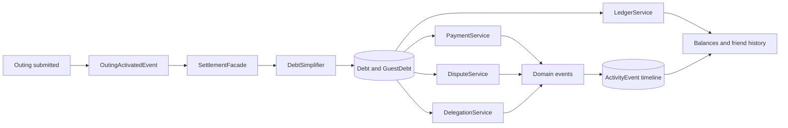

# Koto Pai Ledger Settlement and History Report

This section records the completed Member 3 work for the project report and presentation. The ledger slice now covers debt generation, balances, payments, disputes, guest settlement, mutual-friend delegation, reversible delegation disputes, and a durable activity timeline. The verified demonstration path is the burger-night split followed by payment, delegation, and guest settlement.

## Architecture



The outing package publishes lifecycle events instead of writing ledger tables directly. `DefaultDebtService` converts the outing snapshot into net positions, simplifies those positions, and persists debts. Payment, dispute, delegation, and guest-settlement services enforce their own authorization and lifecycle rules. The activity observer converts domain events into a user-visible audit trail.

## Design patterns

### Facade

`SettlementFacade` is the entry point for debt simplification, outing debt generation, delegation suggestions, and delegation execution. Controllers depend on one settlement-facing API rather than coordinating several algorithms and services.

### State

`DebtStatus` owns the legal debt transitions. Open debts may become partially paid, paid, disputed, or void. Disputed debts may be reopened or voided. Paid debts cannot return to an active state except through the narrowly scoped restoration used to reverse a delegation. This keeps invalid transitions out of controllers and repositories.

### Observer

Spring application events decouple ledger operations from the activity timeline and notification consumers. Outing creation, debt creation, payment recording and confirmation, disputes, delegation execution and reversal, and guest settlement all publish typed events. `ActivityEventListener` persists these events before transaction commit so failed business operations do not create misleading history.

### Strategy ready simplification

`DebtSimplifier` is a pure Java greedy implementation that matches the largest debtor with the largest creditor. It preserves money and produces at most `n - 1` transfers. Its isolated API allows a different simplification strategy to be introduced without changing persistence or controllers.

## Security controls

All ledger, debt, payment, guest-debt, delegation, and activity API routes require authentication. Controllers derive the user ID from the authenticated principal; client-supplied user IDs are not trusted.

Resource checks are enforced in services:

- Only the debtor or creditor may record a payment, and only the creditor may confirm a pending payment.
- Only the debtor or creditor may dispute a debt.
- Only the guest owner may settle a guest debt.
- Only the middleman who is both owed and owing may execute a delegation.
- Delegation requires the two outer users to be accepted mutual friends.
- Only the delegated debtor or creditor may dispute and reverse a delegation.
- Ledger and activity reads are scoped to the authenticated user.

Request DTOs validate positive IDs, positive amounts, two-decimal precision, and nonblank dispute reasons. `@Version` on `Debt` prevents concurrent updates from silently overwriting each other.

## Test evidence

The complete Maven lifecycle passed on 18 November 2026 with 522 unit tests and 42 integration tests. The integration suite includes `ConcurrentPaymentIT`, which proves that two simultaneous ৳60 attempts against a ৳100 debt result in one payment and ৳40 remaining.

Member 3 coverage includes:

- Burger-night simplification, many debtors to one creditor, perfect cycles, money conservation, and the `n - 1` transfer bound.
- Partial delegation, rejected non-friends, and suggestion discovery.
- Debt generation, guest proxy records, ledger totals, disputed-debt exclusion, and per-friend history.
- Pending and confirmed payments, partial payment, final settlement, disputes, guest settlement, and resource authorization.
- End-to-end delegation, ledger conservation after delegation, reversal through dispute, activity persistence, unauthenticated access, and forbidden actors.
- Concurrent direct payment attempts guarded by optimistic locking.

Run the same checks locally with:

```powershell
.\mvnw.cmd verify
```

GitHub Actions runs unit tests first and integration tests second on pushes and pull requests to `main` and `develop`. It uploads Surefire, Failsafe, JaCoCo unit coverage, and JaCoCo integration coverage artifacts. Use the Actions run summary and uploaded reports as the final CI screenshots for the submitted report.

## Presentation outline

### Problem and product

Friends often remember who paid but not who consumed each item. Koto Pai records consumption and contributions, calculates net positions, and maintains a settlement ledger without deleting history.

### Burger-night calculation

Use the agreed example:

| Person | Consumed | Paid | Net |
| --- | ---: | ---: | ---: |
| Rafsan | ৳700 | ৳1,400 | +৳700 |
| Tanvir | ৳800 | ৳500 | -৳300 |
| Nabila | ৳400 | ৳0 | -৳400 |

The simplified result is Tanvir → Rafsan ৳300 and Nabila → Rafsan ৳400. Point out that the nets sum to zero and only two transfers are needed.

### Settlement lifecycle

Show Nabila selecting “I paid.” The payment remains pending until Rafsan confirms it. Demonstrate a partial confirmation first, then the final confirmation. The debt moves from `OPEN` to `PARTIALLY_PAID` to `PAID`, and the outing settles when every non-void debt is paid.

### Dispute behavior

Dispute one open debt with a short reason. The debt remains in history but disappears from balance totals. Explain that the outing creator can correct the outing, remove the participant, or cancel the outing.

### Delegation

Use Nabila → Samiha and Samiha → Rafsan with Nabila and Rafsan as mutual friends. Open the settle-up page, show the smart suggestion, and execute the direct Nabila → Rafsan debt. Then dispute the delegated debt to demonstrate that the direct debt becomes void and both original balances are restored.

### Guest proxy

Show a named guest owned by the outing creator. Other registered users see only their debt with the creator. The creator marks the guest debt settled; the record remains in history.

### Activity and history

Finish on the activity timeline and filter by type or friend. Open a per-friend history page to show debts and the related payment, dispute, and delegation events together.

## Demo script

1. Sign in as Rafsan and submit the burger-night outing.
2. Open balances and verify “You’ll get” is ৳700, with Tanvir owing ৳300 and Nabila owing ৳400.
3. Sign in as Nabila, record a partial payment, then sign in as Rafsan and confirm it.
4. Dispute a remaining outing debt and show that dashboard totals change while the history entry remains.
5. Prepare Nabila → Samiha and Samiha → Rafsan debts, confirm Nabila and Rafsan are friends, and execute the settle-up suggestion.
6. Dispute the delegated debt and show the original debts restored.
7. Mark the creator-owned guest debt settled.
8. Open Activity and the per-friend history page to show the full audit trail.
9. End with the CI summary and test report artifacts.

## Final submission assets

The report should include screenshots of the dashboard totals, pending and confirmed payment states, disputed balance exclusion, delegation suggestion and reversal, guest settlement, activity timeline, and the green GitHub Actions run. The presentation should reuse the architecture diagram and burger-night table above. Deployment commands should be taken from the final team deployment configuration once the app hosting and PostgreSQL environment are selected.
