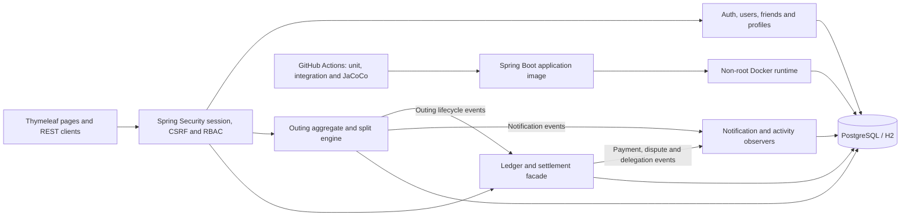

# Koto Pai Project Report and Demo Pack

This document coordinates the final technical report and presentation evidence across all three members. The ledger slice covers debt generation, balances, payments, disputes, guest settlement, mutual-friend delegation, reversible delegation disputes, and a durable activity timeline. The verified demonstration path is the burger-night split followed by dispute resolution, payment, delegation, and guest settlement.

## Architecture



The modules communicate through ports and application events rather than cross-writing each other's tables. `SplitEngine` calculates exact participant nets, `DefaultDebtService` simplifies and persists them, and settlement services enforce authorization and lifecycle rules. Notification and activity observers turn domain events into user-visible messages and an audit trail.

## Team evidence matrix

| Owner | Delivered area | Patterns represented in code | Test evidence | Security boundary |
| --- | --- | --- | --- | --- |
| Member 1 | Authentication, users, friends, profiles, notifications, admin and DevOps | Service/Facade (`FriendService`), Observer (`NotificationEventListener`), Repository | Registration/login, friendship rules, profile, notification isolation, admin/RBAC and security integration tests | BCrypt, authenticated-by-default routes, CSRF, `ADMIN` role and resource-scoped notification/profile services |
| Member 2 | Outings, guests, items, contributions, split preview and pages | Strategy + Factory (`SplitStrategy`, `SplitStrategyFactory`), State (`OutingStatus`), Builder (`OutingSnapshot`), Observer (`OutingActivatedEvent`) | Rounding, validation, split engine, mapping, CRUD, preview, submit/cancel and outing authorization tests | Creator-only mutation, creator/participant visibility and payment-locked active outings |
| Member 3 | Debts, ledger, payments, disputes, delegation, history and activity | Facade (`SettlementFacade`), State (`DebtState`), Observer (`ActivityEventListener`), greedy simplification strategy | Simplifier/delegation units; full settlement, authorization, concurrency, activity and history integration tests | Authenticated ledger APIs plus debtor, creditor, guest-owner and delegation-participant checks in services |

## Design patterns

### Facade

`SettlementFacade` is the entry point for debt simplification, outing debt generation, delegation suggestions, and delegation execution. Controllers depend on one settlement-facing API rather than coordinating several algorithms and services.

### State

`DebtStatus` owns the legal debt transitions. Open debts may become partially paid, paid, disputed, or void. Disputed debts may be reopened or voided. Paid debts cannot return to an active state except through the narrowly scoped restoration used to reverse a delegation. This keeps invalid transitions out of controllers and repositories.

### Observer

Spring application events decouple ledger operations from the activity timeline and notification consumers. Outing creation, debt creation, payment recording and confirmation, disputes, delegation execution and reversal, and guest settlement all publish typed events. `ActivityEventListener` persists these events before transaction commit so failed business operations do not create misleading history.

### Strategy ready simplification

`DebtSimplifier` is a pure Java greedy implementation that matches the largest debtor with the largest creditor. It preserves money and produces at most `n - 1` transfers. Its isolated API allows a different simplification strategy to be introduced without changing persistence or controllers.

## Security controls

All application routes are authenticated by default except login, registration and static assets. Admin routes require `ROLE_ADMIN`; API requests return `401` while page requests redirect to login. CSRF remains enabled. Controllers derive the user ID from the authenticated principal, so client-supplied user IDs are never trusted as authority.

Resource checks are enforced in services:

- Only the debtor or creditor may record a payment, and only the creditor may confirm a pending payment.
- Only the debtor or creditor may dispute a debt.
- Only the guest owner may settle a guest debt.
- Only the middleman who is both owed and owing may execute a delegation.
- Delegation requires the two outer users to be accepted mutual friends.
- Only the delegated debtor or creditor may dispute and reverse a delegation.
- Ledger and activity reads are scoped to the authenticated user.

Request DTOs validate positive IDs, positive amounts, two-decimal precision, and nonblank dispute reasons. `@Version` on `Debt` prevents concurrent updates from silently overwriting each other.

## Test evidence

The complete Phase 4 branch verification passed on 25 November 2026 with **615 unit tests** and **77 integration tests**, with zero failures, errors or skipped tests; the JaCoCo coverage gate also passed. A focused hardening run additionally confirmed all 5 debt-state unit tests and all 20 selected Phase 4 integration cases. The selected integration set contains the full settlement flow, the complete ledger/activity route authorization matrix, delegation end to end, and concurrent payment protection.

Member 3 coverage includes:

- Burger-night simplification, many debtors to one creditor, perfect cycles, money conservation, and the `n - 1` transfer bound.
- Partial delegation, rejected non-friends, and suggestion discovery.
- Debt generation, guest proxy records, ledger totals, disputed-debt exclusion, and per-friend history.
- Pending and confirmed payments, partial payment, final settlement, disputes, guest settlement, and resource authorization.
- End-to-end delegation, ledger conservation after delegation, reversal through dispute, activity persistence, unauthenticated access, and forbidden actors.
- Concurrent direct payment attempts guarded by optimistic locking.

`LedgerFullFlowIT` creates and submits a real outing, observes generated debt, disputes it, has the creator regenerate it, records and confirms a partial payment, pays the remainder, and verifies the outing becomes `SETTLED`. `LedgerAuthorizationIT` covers every ledger/activity API and page route as anonymous and verifies that an unrelated authenticated user sees no foreign ledger data and cannot mutate a debt, payment, guest debt or delegation. `ConcurrentPaymentIT` proves that two simultaneous ৳60 attempts against a ৳100 debt result in exactly one payment and ৳40 remaining.

Run the same checks locally with:

```powershell
.\mvnw.cmd verify
```

GitHub Actions runs unit tests first and integration tests second on pushes and pull requests to `main` and `develop`. It uploads Surefire, Failsafe, JaCoCo unit coverage, and JaCoCo integration coverage artifacts. Use the Actions run summary and uploaded reports as the final CI screenshots for the submitted report.

### CI red-to-green evidence

- Red: [failed `feature/m1-seed-and-ports` run 44592651592](https://github.com/narukami00/Koto-Pai/actions/runs/44592651592).
- Green after the fix: [successful run 44595540675](https://github.com/narukami00/Koto-Pai/actions/runs/44595540675).
- Latest green `develop` baseline before Phase 4: [run 45451248844](https://github.com/narukami00/Koto-Pai/actions/runs/45451248844).

For the report screenshots, capture the run header (branch, commit and red/green result), the failed/passing job list, and the four artifact names: `unit-test-reports`, `unit-coverage`, `integration-test-reports`, and `integration-coverage`. The Phase 4 pull request supplies the final green screenshot after push.

## Docker and deployment runbook

The production image uses a three-stage Java 21 build, layered Spring Boot JAR, Alpine JRE, an unprivileged `kotopai` user, and an Actuator health check. Docker Compose starts PostgreSQL 16 with a persistent volume and waits for database health before starting the application.

1. Copy environment values into a local `.env`; never commit production credentials.
2. Run `docker compose up -d --build`.
3. Verify `docker compose ps`, then open `http://localhost:8080/actuator/health` and the application at `http://localhost:8080`.
4. Inspect failures with `docker compose logs -f app`.
5. Stop safely with `docker compose down`; use `docker compose down -v` only when intentionally deleting local database data.
6. For Render, Railway, Fly.io or another container host, deploy the repository Dockerfile, expose port `8080`, set the health path to `/actuator/health`, select profile `prod`, and provide `DB_HOST`, `DB_PORT`, `DB_NAME`, `DB_USER`, `DB_PASSWORD`, `DB_SCHEMA` and `DB_SSLMODE` through the platform secret manager.

The full variable table and standalone managed-PostgreSQL example are maintained in [`DEPLOYMENT.md`](DEPLOYMENT.md).

## Presentation outline

### Problem and product

Friends often remember who paid but not who consumed each item. Koto Pai records consumption and contributions, calculates net positions, and maintains a settlement ledger without deleting history.

### Burger-night calculation

Use the agreed example:

| Person | Consumed | Paid | Net |
| --- | ---: | ---: | ---: |
| Rafsan | ৳700 | ৳1,400 | +৳700 |
| Tanvir | ৳800 | ৳500 | -৳300 |
| Nabila | ৳400 | ৳0 | -৳400 |

The simplified result is Tanvir → Rafsan ৳300 and Nabila → Rafsan ৳400. Point out that the nets sum to zero and only two transfers are needed.

### Settlement lifecycle

Show Nabila selecting “I paid.” The payment remains pending until Rafsan confirms it. Demonstrate a partial confirmation first, then the final confirmation. The debt moves from `OPEN` to `PARTIALLY_PAID` to `PAID`, and the outing settles when every non-void debt is paid.

### Dispute behavior

Dispute one open debt with a short reason. The debt remains in history but disappears from balance totals. Explain that the outing creator can correct the outing, remove the participant, or cancel the outing.

### Delegation

Use Nabila → Samiha and Samiha → Rafsan with Nabila and Rafsan as mutual friends. Open the settle-up page, show the smart suggestion, and execute the direct Nabila → Rafsan debt. Then dispute the delegated debt to demonstrate that the direct debt becomes void and both original balances are restored.

### Guest proxy

Show a named guest owned by the outing creator. Other registered users see only their debt with the creator. The creator marks the guest debt settled; the record remains in history.

### Activity and history

Finish on the activity timeline and filter by type or friend. Open a per-friend history page to show debts and the related payment, dispute, and delegation events together.

## Demo script

1. Sign in as Rafsan and submit the burger-night outing.
2. Open balances and verify “You’ll get” is ৳700, with Tanvir owing ৳300 and Nabila owing ৳400.
3. Sign in as Nabila, record a partial payment, then sign in as Rafsan and confirm it.
4. Dispute a remaining outing debt and show that dashboard totals change while the history entry remains.
5. Prepare Nabila → Samiha and Samiha → Rafsan debts, confirm Nabila and Rafsan are friends, and execute the settle-up suggestion.
6. Dispute the delegated debt and show the original debts restored.
7. Mark the creator-owned guest debt settled.
8. Open Activity and the per-friend history page to show the full audit trail.
9. End with the CI summary and test report artifacts.

## Final submission assets

The report screenshot set is: dashboard totals; pending and confirmed payment states; disputed balance exclusion; delegation suggestion and reversal; guest settlement; activity timeline; the linked red and green CI runs; Docker Compose services; and the Actuator health response. The presentation reuses the architecture diagram and burger-night table above. Deployment commands come from the checked-in Docker and deployment configuration, so report and demo steps remain reproducible.
